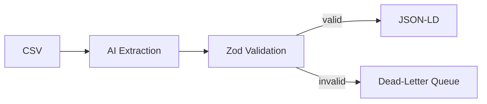

# Medicinal Product Extractor

Reference ETL pipeline that turns unstructured medicinal product descriptions into schema-validated, IDMP-inspired JSON-LD for a knowledge graph.

Medicinal products are identified, in the ISO IDMP model (ISO 11615 and related standards), by substance, strength, pharmaceutical dose form, route of administration, and the organisation that holds the marketing authorisation. Free-text catalogue rows are a poor fit for that model: the same strength may be written as `500 mg`, `500mg`, or `milligrams`, and incomplete rows must not become graph nodes. This project puts a controlled vocabulary and a dead-letter queue between extraction and publication.

The validated domain record keeps the regulatory field name `marketingAuthorizationHolder`. The JSON-LD projection maps that organisation onto schema.org `manufacturer` so the node can sit beside other `Drug` resources. The `@context` is a project vocabulary aligned with schema.org and IDMP concepts. It is not an official ISO publication, and this repository is not a certified IDMP submission system.

## Architecture



1. Read a CSV of free-text descriptions.
2. Extract a fixed field set. Live mode calls an OpenAI-compatible model with Structured Outputs (`json_schema`, `strict: true`). Mock mode parses the sample prose locally.
3. Canonicalize synonyms, then validate with Zod. Strength must be a finite number greater than zero. Unit, dose form, and route must belong to the controlled lists.
4. Write accepted records to `output/products.jsonld` and rejected records, with reasons, to `output/dead_letter.json`.

## Project structure

```text
data/sample_products.csv     Five catalogue rows and one incomplete row
src/schema.ts                Zod schemas and controlled vocabularies
src/extractor.ts             Live Structured Outputs client and mock extractor
src/transformer.ts           MedicinalProduct -> schema.org Drug JSON-LD
src/index.ts                 CSV read, validation, dead letter, CLI
tests/pipeline.test.ts       Schema, JSON-LD, and end-to-end tests
.github/workflows/ci.yml     Typecheck and test on push and pull request
```

## Requirements

- Node.js 22 or newer
- An OpenAI API key only if you run live extraction

## Setup

```bash
npm install
cp .env.example .env
```

Put a real key in `.env` when you want live extraction. The placeholder `your_key_here` is treated as missing, so the pipeline stays on the mock extractor. Existing environment variables take precedence over `.env`.

```bash
OPENAI_API_KEY=your_key_here
```

Optional settings:

```bash
OPENAI_MODEL=gpt-4o-mini
OPENAI_BASE_URL=https://api.openai.com/v1
```

`OPENAI_BASE_URL` can point at an OpenAI-compatible endpoint. The default model is `gpt-4o-mini`, which supports Structured Outputs. Set `OPENAI_MODEL` when your account uses a different model.

## Run the pipeline

From the repository root:

```bash
npm run start -- --mock
```

```bash
npm run start
```

`npm run start` uses the live API when `OPENAI_API_KEY` is set to a real key. Otherwise it prints a warning and uses the mock extractor, so a local run does not call the network by accident.

```bash
npm run start -- --mock --input data/sample_products.csv --output output
```

A successful mock run prints:

```text
Medicinal product extraction
----------------------------
Mode:        mock
Processed:   6
Succeeded:   5
Failed:      1
JSON-LD:     .../output/products.jsonld
Dead letter: .../output/dead_letter.json
```

Validation rejects are a completed run: the process exits 0 and the bad row is in the dead-letter file. The process exits 1 when the input cannot be read or the model request itself fails (authentication, network, or an unavailable model). Those failures are not written as data rejects.

### Mock extractor cues

The offline extractor is deterministic. It reads these phrases from each description:

- `medicinal product {Name}`
- `supplied as a {dosage form} containing the active substance {substance} at a strength of {number} {unit}`
- `given by the {route} route`
- `marketing authorization holder is {organisation}`

British spelling `authorisation` is accepted. Units `mg`, `g`, `mcg`, `ml`, `IU`, and `%` are recognized, then normalized (`ml` becomes `mL`). Dose forms and routes are mapped onto the lists in `src/schema.ts`.

`data/sample_products.csv` contains five rows that follow those cues and one warehouse note (`MP-1006`) that deliberately omits them. `MP-1004` includes a comma inside the quoted holder field so the CSV parser, not a naive split, owns the columns.

## Output

`output/products.jsonld` is one JSON-LD document. The shared `@context` applies to every node in `@graph`. Each node is a schema.org `Drug` with a stable `@id`. `toJsonLd()` can also return that node with the context embedded, so a single record stays valid on its own:

```json
{
  "@context": {
    "schema": "https://schema.org/",
    "idmp": "https://example.org/idmp/",
    "Drug": "schema:Drug"
  },
  "@graph": [
    {
      "@type": "Drug",
      "@id": "urn:idmp:medicinal-product:MP-1001",
      "name": "Helixor",
      "activeIngredient": "paracetamol",
      "dosageForm": "Film-coated tablet",
      "administrationRoute": "Oral",
      "manufacturer": {
        "@type": "Organization",
        "name": "Helix Therapeutics Ltd"
      },
      "availableStrength": {
        "@type": "QuantitativeValue",
        "value": 500,
        "unitText": "mg"
      }
    }
  ]
}
```

`availableStrength` is mapped to `idmp:strength` and carried as a `QuantitativeValue`, which is the structured strength a graph needs. schema.org's own `availableStrength` is often a string; this document prefers the quantitative form.

`output/dead_letter.json` records the source id, the stage (`parse`, `extraction`, or `validation`), the raw extraction, the candidate that failed, and Zod issue paths. Duplicate `product_id` values are quarantined so a graph does not gain two nodes with one `@id`.

`output/` is gitignored. Re-running the pipeline replaces both files.

## Test

```bash
npm test
npm run typecheck
```

`npm test` runs Vitest once (`vitest run`). The suite covers:

- schema acceptance, unknown keys, missing fields, non-positive and non-finite strengths, and values outside the controlled vocabularies
- JSON-LD `@context`, `@type`, `@id`, strength, ingredient, dose form, route, and manufacturer
- an end-to-end mock run of the sample file, including the dead letter for `MP-1006`
- automatic fallback when no API key is configured

Tests do not call the OpenAI API.

## Continuous integration

`.github/workflows/ci.yml` runs on every push and pull request:

- `npx tsc --noEmit`
- `npm test`

The workflow does not need `OPENAI_API_KEY`.
